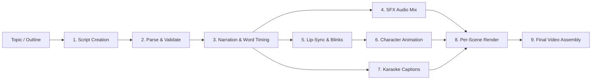

# PROJECT OVERVIEW: Automated 2D Character Video Pipeline

## 1. One-Paragraph Summary

This project is an automated, local-first video production pipeline that turns a topic or structured Markdown script into a finished, broadcast-ready 2D animated video. Built for a solo creator running multiple YouTube channels (both 16:9 long-form videos and 9:16 vertical Shorts), its goal is to eliminate manual timeline editing in tools like CapCut by automatically synthesizing expressive voice narration, aligning word and mouth timings, animating a layered 2D mascot with eye blinks and idle motion, compositing scene illustrations and captions, and assembling the final video with verified sub-frame audio/video synchronization.

---

## 2. Channels and Characters

The pipeline is multi-channel and character-agnostic, driven entirely by per-channel configuration files:

* **Main Comedy-Explainer Channel ("CBBob" / Bob, formerly "Deadpan Doug")**: Features a sarcastic, deadpan 2D stick-figure host in a mustard-yellow hoodie and scarf who speaks directly to the viewer, roasting bad habits and internet myths while explaining real research accurately.


* **Faceless Explainer Channel ("Atlas")**: Features the Atlas lightbulb mascot for straightforward educational explainers.


* **How They Differ**: Both channels share the exact same rendering engine and layered character architecture, differing only in their configuration profiles (voice settings, pacing/lint thresholds, layout defaults, and character layer kits).


---

## 3. End-to-End Pipeline Overview



| Stage | Purpose | Status |
| --- | --- | --- |
| **1. Script Creation** | Turn a topic into a strict, spec-compliant Markdown script with emotion tags, pauses, and inline visual/audio cues.

 | **PENDING** (Manual via LLM prompt today) |
| **2. Parse & Validate** | Parse Markdown into a structured project model; enforce vocabulary, digit rules, pacing budgets, and scene layout rules.

 | **DONE** |
| **3. Narration (Voice)** | Generate per-segment speech using local neural TTS, apply emotion speed/volume profiles, polish audio, normalize loudness, and extract word timings.

 | **DONE** |
| **4. Audio Mixing & SFX** | Place point sound effects and looped, faded background beds onto the normalized narration timeline.

 | **DONE** (Music & ducking: **PENDING**)

 |
| **5. Lip-Sync** | Extract mouth viseme timings from segment audio using the known script text, and schedule deterministic eye blinks. | **DONE** |
| **6. Character Animation** | Composite layered RGBA character sprites across a frame-snapped timeline with continuous idle bounce and sway.

 | **DONE** |
| **7. Captions** | Build sentence-chunked karaoke subtitles with word-by-word highlight timing from display text.

 | **DONE** |
| **8. Scene Rendering** | Composite scene backgrounds, reaction cutaways, animated character overlays, and burned captions into per-scene video files. | **DONE** (Camera zoom/pan & cutaway fix: **BUILT-UNVERIFIED**) |
| **9. Final Assembly** | Concatenate rendered scene videos without re-encoding, mux master audio once, and verify sub-frame audio/video sync. | **BUILT-UNVERIFIED** (1-scene mux is **DONE**) |

---

## 4. Character System

* **Layered RGBA Kit Architecture**: Each character is a set of 1000×1000 transparent PNG layers stacked at the origin (`base` $\rightarrow$ `props` $\rightarrow$ `eyes` $\rightarrow$ `brows` $\rightarrow$ `mouth`) defined by a JSON manifest. There is no green screen or chroma keying.


* **Shared Mouth Set & Emotion Poses**: Because the character's head and torso stay in a fixed position across poses, a single 9-shape mouth set (visemes `A`–`H` plus closed `X`) serves all emotions. Emotions swap lightweight upper-face layers (eyelids, eyebrows) and optional arm/prop layers.


* **Blinks, Caching & Motion**: Blinks swap the open-eye layer for a closed-eye layer on a seeded random schedule. Every unique combination of pose, eye state, and mouth shape is composited once into a trimmed PNG and cached on disk. Smooth sinusoidal bounce and sway are applied with phase continuity across scene cuts.


* **Readiness**:
* **Atlas**: **DONE** — Full 12-layer basic kit (`base`, open/closed eyes, 9 mouths) is validated and verified in rendered video.


* **CBBob**: **IN PROGRESS** — Manifest and layer-extraction tooling (from Krita/Photopea archives) are **DONE**; the creator is currently producing the 12-layer basic rig first, followed by ~14 additional eye, brow, and prop layers for multi-emotion poses.


---

## 5. Visual Layout Concept

* **Hybrid Per-Scene Layouts**: Each scene specifies one of three layouts: full-frame scene illustration (`full_scene`), scene illustration with the animated character overlaid in the left corner/side (`bob_pip`), or full-screen animated character for punchlines (`bob_full`).
* **Cutaways, Camera & Overlays**: Inline script cues trigger timed reaction image cutaways (with early return support), base camera movements (`zoom_in`, `zoom_out`, `pan_left`, `pan_right`, `hold`), transient camera effects (`punch_in`, `shake`), and short uppercase on-screen text overlays (`slam`, `pop`, `jitter`, `shrink`, `fade`).


---

## 6. Key Design Decisions and Why

* **Per-scene cached rendering**: Rendering scenes independently by content hash keeps memory flat and means editing one line only re-renders that single scene.
* **Four-tier resumable caching**: Raw TTS audio, processed audio, lip-sync/word sidecars, and rendered scene clips are content-hashed and written atomically so interrupted builds resume instantly.


* **Frame-snapped video + single audio mux**: Snapping scene boundaries and character cues to exact frame counts and muxing the master audio track once at the end prevents cumulative audio/video drift.
* **Subprocess stage isolation**: Running neural voice synthesis in an isolated child process forces the operating system to reclaim 100% of the ~1.4 GiB PyTorch memory before lip-sync and video rendering begin.
* **Dialog-driven lip-sync**: Passing the known script text into Rhubarb Lip Sync improves viseme accuracy over raw phonetic guessing while keeping phonetic mode as an automatic fallback.
* **Per-scene burned captions**: Burning subtitles during per-scene rendering allows final multi-scene assembly to be a sub-second lossless stream copy.

---

## 7. Constraints and Environment

* **Machine Class**: Fedora Linux 44 Workstation, 12 CPU cores (AMD Ryzen 5000U APU), 7.1 GiB total RAM (~4.5 GiB available with heavy apps closed; ~1.4 GiB when browsers/IDEs are open), with `systemd-oomd` active.
* **Design Impact**: Precluded Python in-memory video frame servers and monolithic full-video filter graphs; dictated sequential scene rendering (`workers=1`), subprocess isolation per stage, and an automatic memory preflight warning when available RAM drops below 2 GiB.
* **Pre-Build Practice**: Close browsers and IDEs before running full builds.

---

## 8. Current Status Table

| Capability / Milestone | Status | Notes |
| --- | --- | --- |
| Script parser, validator & lint report | **DONE** | Supports character aliases and per-scene layout fields.

 |
| TTS narration, audio polish & two-level cache | **DONE** | Kokoro TTS + 2-pass loudness normalization + atomic WAV I/O.

 |
| Word-level timing & pronunciation alignment | **DONE** | Preserves exact token alignment across phonetic respellings.

 |
| Point & bed SFX audio mixer | **DONE** | Mixes point sounds and looped/faded beds over narration.

 |
| Helper tools (prompts, cue sheet, chapters, layer exporter) | **DONE** | Extracts image prompts, CapCut sheets, YouTube chapters, and kit layers.

 |
| Character kit spec & validator (M1.1) | **DONE** | Validates dimensions, RGBA mode, union trim box, and SHA-256 hash. |
| Rhubarb lip-sync stage & caching (M1.2) | **DONE** | Dialog-assisted recognition with fallback and per-segment caching. |
| Layered character & single-scene renderer (M1.3) | **DONE** | Frame-quantized timeline, composite cache, burned scene captions. |
| Subprocess isolation & 1-scene benchmark (M1.4) | **DONE** | Verified on real Kokoro + Rhubarb + Atlas kit. |
| PiP cutaway persistence & active camera zoom/pan (M1.4 patch) | **BUILT-UNVERIFIED** | Code delivered; awaiting user test run and visual check. |
| Multi-scene assembler & drift verification (M1.5) | **BUILT-UNVERIFIED** | Code delivered; awaiting user test run. |
| Visual upgrades: text overlays, emotions, music ducking (M2) | **PENDING** | Next major phase after M1.5 verification. |
| Automated LLM script generation via Gemini API (M4) | **PENDING** | Planned after visual upgrades. |
| Multimodal AI frame/video critique | **IDEA** | Discussed for post-render quality checks. |

---

## 9. Verified Results So Far

* **Unit & Integration Tests**: 214 automated tests passing across parsing, validation, narration, word timing, mixing, kit validation, lip-sync, scene rendering, and subprocess telemetry.
* **12-Segment Lip-Sync Run**: Completed across all 12 segments of the two-scene test fixture using real Rhubarb with 0 fallbacks; subsequent run finished in 0.0 s from cache.
* **1-Scene End-to-End Benchmark (Real Kokoro + Real Rhubarb + Atlas Kit)**:
* **Wall Time**: 43.5 s total (narration: 24.5 s, lip-sync: 7.8 s, scene render: 8.85 s, audio/video mux: 0.96 s).
* **Per-Stage Peak Memory (RSS)**: Narration: 1,365 / 1,448 MiB; Lip-Sync: 157 / 503 MiB; Scene Render: 871 / 910 MiB; Mux: 68 MiB.
* **Sync Accuracy**: 0.48 frames audio/video drift (passed `< 1.0 frame` threshold).
* **Visual Review**: Lip-sync, eye blinks, idle motion, and karaoke captions all verified working.


---

## 10. Known Issues and Risks

* **Unverified M1.4 Patch & M1.5 Code**: The fix keeping the PiP mascot visible during reaction cutaways, the active camera zoom/pan filter, the `mid_left` PiP default, and the multi-scene assembler are **BUILT-UNVERIFIED** until the user runs the latest test commands.
* **Scene Render Memory with Real 1080p Art**: Scene rendering peaked at ~910 MiB on a plain canvas; the true peak with a 1920×1080 illustration and active camera zoom/pan is awaiting measurement in the latest patch.
* **Unimplemented Visual Cues**: On-screen text overlays (`{text:WORDS|style}`) are parsed and timed, but not yet drawn onto the video frame.
* **Missing Production Assets**: Bob's layered PNG kit, custom scene illustrations, and several SFX files still need to be added to the assets directory.


---

## 11. Pending Work and Roadmap

1. **Verify M1.4 Patch & M1.5 (NEXT)**: Run unit tests, measure render-only memory with a 1920×1080 background and camera zoom, and verify full multi-scene assembly and drift check.
2. **Phase 3 / M2 — Visual & Audio Upgrades**:
* Render animated on-screen `{text:}` overlays (`slam`, `pop`, `jitter`, `shrink`, `fade`).


* Plug in Bob's layered kit + emotion pose switching (`eyes`, `brows`, `props`) driven by script emotion tags.
* Refine camera moves (`punch_in`, `shake`), scene transitions, and background music mixing with automatic voice ducking.


3. **M3 — 9:16 Vertical Shorts & Export Presets**: Verify and tune vertical framing (`1080×1920`) for Shorts scripts.


4. **M4 — Automated Script Generation**: Build Topic/Outline $\rightarrow$ validated Markdown script generation using the Gemini API with search grounding and automatic validation retries.
5. **M5 — Polish & Documentation**: Finalize configuration presets, README, and workflow guides.

---

## 12. Assets and Inputs Still Needed

* **Priority 1 (Unblocks Bob Renders)**: Bob's 12-PNG basic layered kit (`1000×1000` RGBA: `base`, `eyes_open`, `eyes_closed`, `mouth_A..H`, `mouth_X`).
* **Priority 2 (Core Production)**: Per-scene 16:9 illustrations (from the prompt sheet) and missing WAV/MP3 files in the SFX library.


* **Priority 3 (Expressive Polish)**: Bob's extra emotion layers (~4 eye variants, 5 brow variants, optional props/arms) and background music loops.


---

## 13. Working Agreement with the AI Collaborator

* Work **one sub-milestone at a time** and wait for user test results before moving on.
* Never modify code until the plan is approved.
* Provide **complete, pasteable file contents** (no partial diffs or snippets), exact test commands, manual run commands, and a one-line commit message.
* Never claim or invent unmeasured performance/memory numbers; label unverified work honestly.
* Justify any new dependency and prefer simple, local tools (FFmpeg, Pillow, NumPy, Rhubarb).


* Preserve existing working behavior and tests unless explicitly agreed otherwise.


---

## 14. Open Questions

* What exact typography, position, and animation curves should each of the five `{text:}` overlay styles (`slam`, `pop`, `jitter`, `shrink`, `fade`) use?
* After viewing the `mid_left` PiP placement, should `mid_left` or `top_left` be the permanent default for Bob and Atlas?
* What target gain and ducking ratio should background music use under spoken narration?

---

## PASTE-READY CONTEXT HEADER

```text
PROJECT CONTEXT: I am building a local, automated Python + FFmpeg video pipeline on Fedora Linux (12 cores, 7.1 GiB RAM, ~4.5 GiB free) for two YouTube channels: a deadpan comedy-explainer channel ("CBBob") and a faceless explainer channel ("Atlas"). It turns a strict Markdown script (with emotions, pauses, and inline {sfx}, {bed}, {img}, {cam}, {text} cues) into a finished MP4.

DONE & VERIFIED: Script parser/validator, Kokoro TTS narration with 2-level content caching and 2-pass loudnorm, pronunciation-aware word timing, SFX mixer, dialog-assisted Rhubarb lip-sync, 1000x1000 RGBA layered character renderer (shared mouth visemes A-H/X, seeded blinks, phase-continuous bounce/sway), burned ASS karaoke captions, subprocess stage isolation, and a 1-scene vertical slice (43.5s wall, 1448 MiB TTS peak, 910 MiB render peak, 0.48-frame A/V drift, 214 tests passing).

WORKING RULES: No code before plan approval. Build one sub-milestone at a time. Deliver complete files (no fragments), exact test/run commands, and a commit message. Never invent unmeasured numbers.

Current focus: Verifying the M1.4 patch (PiP cutaway persistence, active camera zoom/pan, 1920x1080 render-only memory) and M1.5 multi-scene assembly + ffprobe drift check, then starting Phase 3 (Visual Upgrades).

```
